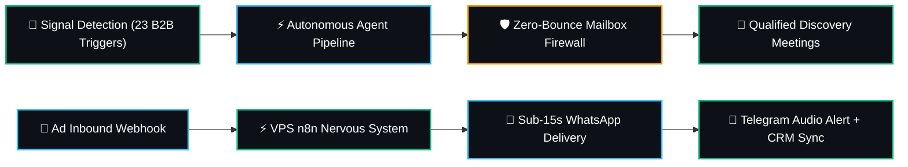
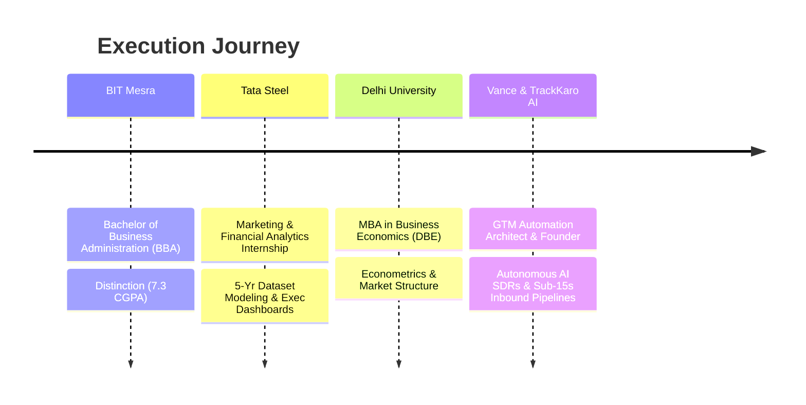

# Hey! 👋 I’m Mangal.

[](https://mangalbuilds.github.io/portfolio/)
[](https://www.linkedin.com/in/mangal-soren-1312ba31/)
[](https://github.com/mangalbuilds)
[](#)

> **AI Product Manager • GTM Automation Architect • Growth Engineer**  
> *I don't pitch theoretical slides. I design, build, and deploy production-grade autonomous GTM systems, webhook pipelines, and agent workflows that drive real pipeline and revenue.*

---

### ⚡ What I Actually Do (No Fluff)



- **Autonomous Outbound Engines:** Eliminating cold spray-and-pray by monitoring 23 deterministic buying signals (hiring surges, competitor stack churn, funding rounds, reverse-IP de-anonymization) and writing 1-to-1 researched founder angles.
- **Sub-15s Speed-to-Lead:** Eliminating lead decay by routing inbound ad forms directly to buyer WhatsApp inboxes with instant brochure assets, triggering phone sound alerts for sales reps in <15 seconds.
- **Pre-Market Talent Discovery:** Reverse-engineering early-stage startup hiring by crawling Ashby/Greenhouse/Lever APIs before jobs hit public job boards.

---

### 🚀 Production Systems & Products

| Product | Architecture & What It Solves | Stack & SLA | Status |
| :--- | :--- | :--- | :--- |
| **⚡ [TrackKaro AI & Vance](https://usevance.com/)**<br>([GitHub](https://github.com/mangalbuilds/growth-os)) | **Autonomous B2B GTM OS:** Combines outbound intent SDR engine (23 deterministic buying signals, AI researcher, 1-click safety switch) with sub-15s inbound speed-to-lead nervous system. Replaces manual agency scraping with an autonomous revenue worker. | Python • FastAPI • SQLite • Groq/Gemini Flash • Reoon API • `<3%` Bounce SLA | [](https://usevance.com/) [](https://trackkaroai.com/) |
| **🎯 [Prex](https://getprex.com/)**<br>([GitHub](https://github.com/mangalbuilds/getprex)) | **Pre-Market Talent Intelligence:** Uncovers stealth, unlisted AI PM, Growth Engineer, and Founder's Office roles 2–4 weeks before public aggregators. Features 1-tap direct founder dispatch, verified emails, real-time Telegram alerts, and in-app resume-to-JD diagnostics. | Python • SQLite • Supabase Auth • Razorpay (₹499/mo) • Coolify VPS | [](https://getprex.com/) [](https://instagram.com/getprex) |
| **⚡ [GTM Agentic Engine](https://github.com/mangalbuilds/gtm-n8n-agentic-engine)** | 6 production n8n workflows: Serper scraping, 3-rule LLM guardrail evaluation, duplicate hashing, and automated CRM routing. | Self-hosted n8n • Docker • Gemini 1.5 Flash • Trello/NocoDB | [](https://github.com/mangalbuilds/gtm-n8n-agentic-engine) |
| **🏠 UGhar** | Hyperlocal home-services on-demand booking platform with instant OTP login, technician dispatch workflows, and flat ₹99 inspection pricing. Tested field ops in Jamshedpur. | Firebase • Supabase • Coolify • JavaScript | [](#) |
| **🎌 Kanjo**<br>([Live](https://kanjo.co.in/)) | Mood-based anime discovery engine eliminating search paralysis by mapping feelings & themes to curated watchlists. | Supabase • Vanilla JS • Curated Schema | [](https://kanjo.co.in/) [](https://instagram.com/kanjo.archive) |
| **📊 Creatorlytics** | Sponsorship, brand deal pipeline, and dynamic revenue tracker designed for digital creators. | Supabase • Chart.js • REST APIs | [](#) |
| **🤖 [Claude Code CLI](https://github.com/mangalbuilds/claude-code-cli)** | Multi-provider developer agent CLI orchestrating Gemini 2.5 Flash, Claude 3.5, and local Ollama models with persistent file tools. | Node.js • Multi-LLM Orchestration | [](https://github.com/mangalbuilds/claude-code-cli) |

---

### 🛠️ Production Stack & Tooling

```
  Core Language & Backends    ───►  Python, JavaScript (ES6+), Node.js, FastAPI, SQLite, Supabase
  Agentic & Automation Loop  ───►  Self-hosted n8n, Webhook Pipelines, Docker, Coolify VPS
  AI & Intelligence Layer    ───►  Gemini 1.5/2.5 Flash, Groq LLM, Claude 3.5, Serper API, Reoon Deliverability API
  Frontend & Product UI      ───►  Modern Obsidian Dark Tech, TailwindCSS, CSS Glassmorphism, Chart.js
  Telemetry & Push Alerts    ───►  Telegram Bot API (Instant Audio Pings), Meta WhatsApp Cloud Webhooks, NocoDB CRM
```

---

### 💼 How I Think & Operate

```
  1. Build Over Theory      Deploy working prototypes & live webhook pipelines rather than writing 40-page PRDs no one reads.
  2. Protect The Core SLA   Deliverability (<3% bounce) and speed (<15s lead contact) are hard constraints, not nice-to-haves.
  3. Grounded In Signals    Zero generic cold templates. Every outbound outreach must cite an observable, verifiable business trigger.
  4. Full-Stack Execution   From market thesis, pricing models (₹499/mo to $1,500/mo retainers), VPS deployments to copy & UI design.
```

---

### 📚 Background & Education



- **MBA (Business Economics)** — Department of Business Economics, University of Delhi
- **BBA** — Birla Institute of Technology, Mesra (BIT Mesra) • *Distinction*
- **Internship:** Tata Steel Ltd (Financial & Marketing Analytics)

---

### 📬 Direct Dispatch

- 🌐 **Portfolio:** [mangalbuilds.github.io/portfolio](https://mangalbuilds.github.io/portfolio/)
- 💼 **LinkedIn:** [linkedin.com/in/mangal-soren-1312ba31](https://www.linkedin.com/in/mangal-soren-1312ba31/)
- 🐙 **GitHub:** [@mangalbuilds](https://github.com/mangalbuilds)
- ✉️ **Founder Inquiries:** `mangal@usevance.com` • `mangal@trackkaroai.com`
- 💬 **WhatsApp:** [+91 9771783048](https://wa.me/919771783048)

> *"Building systems that do the work, convert the lead, and prove the math."*
